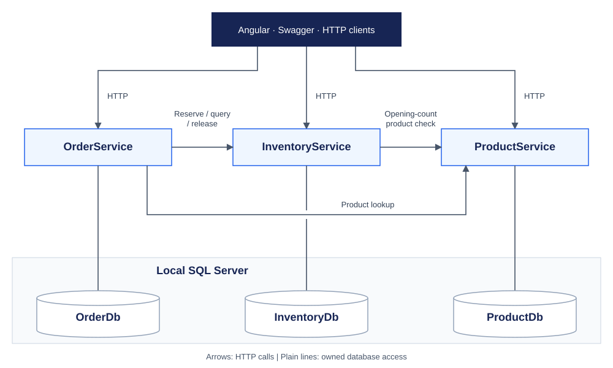
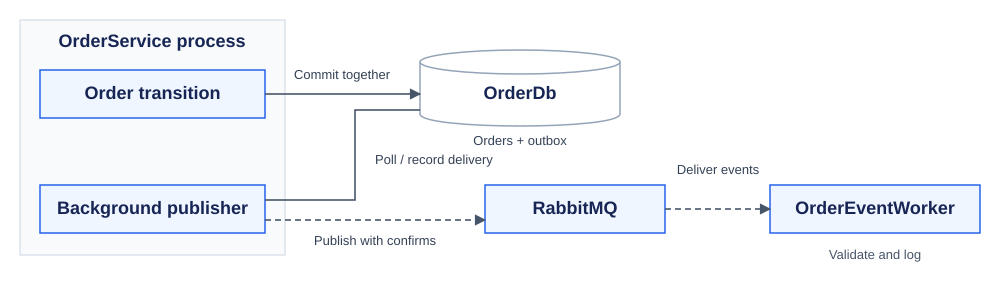
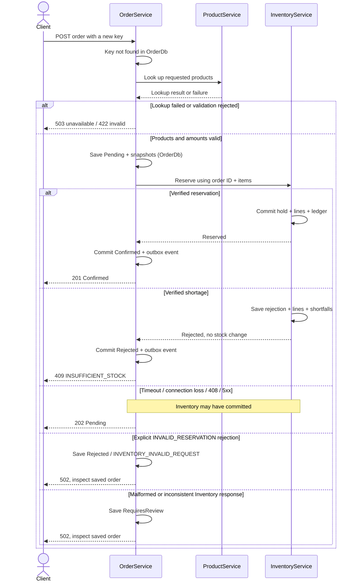

# QubeErp: ERP Stock Movement System

QubeErp is a C# ASP.NET Core technical assessment for QUBE Apps. It models a small ERP workflow: create products, record physical stock, accept multi-product orders and reserve every requested item together. If one item is short, the system reserves nothing for that order.

The backend uses .NET 10, EF Core and SQL Server, with an Angular operations frontend. Product, Inventory and Order run as separate services. RabbitMQ carries order notifications after the stock decision; it does not decide whether an order can be accepted.

## What the System Covers

| Assessment requirement | Current implementation |
|---|---|
| Product module | Create, list, search and retrieve products; batch lookup and explicit activation/deactivation |
| Inventory module | Opening counts, physical stock adjustments, additive receipts, current balances and an audit ledger |
| Multi-item orders | Saved catalogue/price snapshots, atomic reservations, durable shortages and cancellation with verified stock release |
| Clear service boundaries | Three APIs, three owned databases and typed HTTP clients; no cross-service table access |
| Distributed failure handling | Stable retry identities, Pending recovery, transactional outbox and asynchronous notifications |
| Reviewable deliverables | Source, this README, runnable Docker Compose, Swagger/OpenAPI and an HTTP walkthrough |

The Angular frontend provides product, inventory, order, reservation and movement views. Its Overview summarises the latest 20 orders, not global totals. All backend operations can also be explored through Swagger.

This is a local assessment/demo. A Confirmed order holds stock but does not ship it. Fulfilment, payments, returns and production deployment are outside the implemented scope.

## Architecture Overview



Solid arrows point from the HTTP caller to the receiving API; responses return on the same connection. Plain lines connect each API to its own database. InventoryService checks ProductService only when opening stock for a product without an existing stock record. The Angular development proxy forwards requests to these APIs and is omitted from the diagram.

Order notifications follow a separate asynchronous path:



OrderService saves an order transition and its event in one OrderDb transaction. Its background publisher reads committed outbox entries, publishes them to RabbitMQ and records delivery or retry information. Dashed arrows show event flow to OrderEventWorker, which validates and logs notifications. The publisher runs within OrderService; it is not another service.

ProductService owns catalogue data and active status. InventoryService owns physical balances, reservation outcomes and original lines, and movements. OrderService owns order state, price snapshots and its outbox. The worker validates and logs events; it has no business database and never changes stock.

Each API has its own EF Core context, migrations and SQL login. The databases share one SQL Server instance for local setup, so this is logical ownership separation rather than independently hosted databases. Services communicate over HTTP instead of reading another service's tables.

Each API uses controllers, application services and its own EF Core DbContext. Shared DTOs and event contracts live in `src/Shared.Contracts`; HTTP and RabbitMQ infrastructure live in `src/HttpCommunication` and `src/Messaging`. The Angular application is in `frontend/`.

## Core Business Workflow

1. Create products and initialise their physical stock in Inventory. Product creation alone does not create stock.

2. Send an order with 1 to 50 distinct products, quantities of 1 to 10,000 and a stable `Idempotency-Key`. OrderService checks an existing key before calling ProductService.

3. For a new key, validate that products exist and are active, then save a Pending order with SKU/name/price snapshots. Missing/inactive products return 422 before a new order or reservation is saved.

4. Reserve Inventory using the saved order ID. All requested lines and their movements share one InventoryDb transaction. Success increases Reserved; a shortage persists a rejected result and its original shortfalls without a partial hold.

5. Save Confirmed or Rejected and its event together in OrderDb. The publisher delivers the event later. If the Inventory response is uncertain, retain Pending so the original request can recover safely.

The sequence below shows a validly formed request with an unused key. Internal database steps belong to their respective services; there is no shared transaction between OrderDb and InventoryDb.



For an existing key, OrderService compares the saved item fingerprint first. Different items return 409. A matching non-Pending order returns its saved outcome without another Product lookup or reservation command. A Pending replay queries the original Inventory reservation and verifies its lines; only a verified not-found response allows resubmitting the original reservation. A recovered confirmation returns 200, while an uncertain result stays 202.

Outbox publication runs independently of this HTTP sequence. The publisher reads committed events, publishes to RabbitMQ and records publication after broker confirmation; the API response does not wait for event delivery.

For example, reserving 3 units from OnHand 20 gives **OnHand 20, Reserved 3, Available 17**. Physical stock has not been shipped. Cancelling that order returns Reserved to 0 only after Inventory verifies release. Its historical reservation lines still show the original quantity 3.

## Key Design Decisions

### Separate responsibilities and data ownership

I separated Product, Inventory and Order because they handle different parts of the same business process. ProductService manages the catalogue, InventoryService controls stock and reservations, and OrderService records customer orders and their saved prices. Each service owns its database, so an order cannot bypass InventoryService to change stock directly. Separate SQL logins reinforce that boundary.

A modular monolith would have been simpler to develop and run. I chose separate services to work through the trade-off: clearer ownership, but more HTTP calls and more ways for a request to fail. In particular, OrderService can lose the response after InventoryService has already reserved stock. That risk shaped the idempotency and recovery logic described below.

### One transaction for a multi-item reservation

An order should not reserve its first product and fail after changing the second. Inventory therefore claims the reservation, locks stock rows in a consistent product order, checks every item, and saves the outcome and movements in one transaction. Guarded updates and SQL constraints also enforce `0 <= Reserved <= OnHand`.

Database-level coordination prevents competing orders from overselling, including across multiple API instances. The trade-off is potential lock contention; bounded retries handle SQL deadlocks. Integration tests cover atomicity and concurrent reservations.

### Separate physical stock from allocation, and record each change

Reducing OnHand as soon as an order is accepted would mix allocation with shipment. QubeErp keeps OnHand, Reserved and `AvailableQuantity = OnHand - Reserved` separate. PUT sets an absolute physical count; receipt POST adds a delivery. Both preserve Reserved.

Each stock change also records its quantity deltas, operation reference and resulting balances in the same transaction. This makes changes auditable and helps verify that duplicate commands do not change stock twice. Historical movement balances are distinct from current inventory.

### Stable identities and Pending recovery for an unknown outcome

The failure that influenced me most was Inventory committing a reservation while OrderService timed out before receiving the response. Blindly retrying with a new ID could reserve stock twice. I used idempotency, a durable Pending order and recovery with the original reservation ID to handle that uncertainty.

Unique SQL keys and canonical item fingerprints prevent conflicting duplicate submissions. Pending recovery verifies the original reservation and reuses the saved order details rather than creating a new hold. The trade-off is that recovery currently requires client replay; there is no scheduled reconciler.

### An outbox for notifications without a broker dependency in the stock decision

I introduced RabbitMQ and the transactional outbox so notifications could be asynchronous without making successful order processing depend on RabbitMQ availability. Publishing directly after saving an order would leave a gap if the process stopped between the two actions. Here, the status change and event commit in the same OrderDb transaction, and a background publisher delivers it later.

The extra publisher and broker add operational work. Messages can be delivered more than once, so any future consumer that changes business data will need to detect duplicates. The current worker validates and logs events only.

## Reliability and Failure Handling

| Situation | Actual behaviour |
|---|---|
| Invalid body, quantity, duplicate item or key | 400 validation problem; no accepted stock command |
| Missing/inactive product on a new order | 422 `INVALID_PRODUCT`; no new order or reservation |
| ProductService unavailable | New orders return 503. First stock initialisation also needs Product; existing inventory and accepted Pending recovery do not repeat that lookup. |
| Any reservation line is short | 409 `INSUFFICIENT_STOCK`; saved rejection, original shortfalls and no partial hold. Restocking does not change that key's outcome. |
| Same key/ID, changed payload | 409 conflict; it is not treated as a separate purchase |
| Inventory timeout, lost connection, 408 or 5xx | 202 Pending; the hold may exist. Retry the original order key/items. GET order never performs recovery. |
| Malformed or inconsistent Inventory response | 502 with RequiresReview; the response does not prove that stock was rejected. An explicit INVALID_RESERVATION rejection is stored as Rejected / INVENTORY_INVALID_REQUEST. |
| Uncertain cancellation | 202 CancellationPending; retry cancel or reconcile-cancellation. Report Cancelled only after verified Released. |
| RabbitMQ unavailable | Orders continue; unpublished events stay in OrderDb and retry later |
| Lost stocktake response/commit acknowledgement | No automatic absolute-write retry. Inspect stock and the ledger before making a separate count. |

Product lookups use bounded timeouts and retries for transient failures. OrderService does not automatically retry uncertain inventory HTTP writes. Recovery preserves the original reservation identity; InventoryService handles bounded SQL deadlock retries internally.

The outbox retries publication with backoff. RabbitMQ uses durable topology, persistent messages and publisher confirms; the worker acknowledges after processing. Delivery is at least once, with no dead-letter queue or guaranteed event ordering.

Cancelled and Rejected are terminal. RequiresReview needs manual investigation. Fulfilled and Consumed are recognised defensively, but fulfilment is not implemented. API health checks verify their own databases, not downstream service availability.

## Getting Started

### Prerequisites and configuration

Install Git, PowerShell and Docker Desktop (Linux containers), with approximately 6 GB of memory available to Docker. For local backend builds use .NET SDK **10.0.401** (`global.json`); Docker-based startup does not require a host SDK. For Angular, use npm and a compatible Node.js version listed in `frontend/package.json`.

From a fresh checkout:

```powershell
git clone https://github.com/chuien9797/qubeERP.git
Set-Location .\qubeERP
.\scripts\Initialize-LocalEnvironment.ps1
docker compose config --quiet
docker compose up --build --detach --wait --wait-timeout 300
docker compose ps
```

The initializer creates ignored `.env` credentials; never commit that file. Setup creates three databases with separate logins, and each API applies its EF migrations. Existing database and broker credentials are not rotated by changing `.env` alone.

Start Angular in another PowerShell terminal, from the checkout root:

```powershell
Set-Location .\frontend
npm ci
npm start
```

Open the [Angular frontend](http://127.0.0.1:4200). Its development proxy forwards API calls to ports 5101 to 5103; if those ports change, update `frontend/proxy.conf.json`.

API health endpoints are available at `/health` on ports 5101 to 5103. RabbitMQ Management runs at [localhost:15672](http://localhost:15672) using credentials from `.env`. SQL Server is exposed locally at `localhost,14330`; published ports bind to loopback.

For a short walkthrough, create products, receive stock, place a multi-item order, replay its idempotency key, test an insufficient-stock request, then cancel and inspect the ledger. For example, reserving 3 from OnHand 20 produces OnHand 20, Reserved 3 and Available 17; cancellation restores availability to 20. Follow [the HTTP walkthrough](docs/reviewer-demo.http) for sample requests and expected responses. Use fresh SKUs and keys.

Normal stop/restart preserves data:

```powershell
docker compose stop
docker compose up --detach --wait --wait-timeout 300
```

If startup fails, inspect `docker compose logs --tail 50 sqlserver database-setup product-service inventory-service order-service`. Avoid `docker compose down -v` unless you intend to delete stored demo data.

## API Documentation

The live Swagger pages are the detailed reference for parameters, validation, request examples, responses and operation names:

| API | Swagger | Main operations |
|---|---|---|
| Product | [localhost:5101/swagger](http://localhost:5101/swagger) | Create/read/search, batch lookup, activate/deactivate |
| Inventory | [localhost:5102/swagger](http://localhost:5102/swagger) | Physical counts, receipts, balances, movements, reserve/query/release |
| Order | [localhost:5103/swagger](http://localhost:5103/swagger) | Create/replay, retrieve/list, cancel and reconcile cancellation |

Each API exposes `/swagger/v1/swagger.json` in Development. Exported [API documentation in Markdown](docs/api-reference.md), an [HTML version](docs/api-reference.html) and [OpenAPI files](docs/openapi/) are included for review. Regenerate the offline references from running APIs with `./scripts/Export-ApiDocumentation.ps1`.

Order creation returns 201 Confirmed, 409 for insufficient stock or conflicting requests, and 202 Pending when the inventory outcome is uncertain. Replays use the original `Idempotency-Key` and payload. Errors use ProblemDetails with numeric `status` and, where an order is stored, a separate `orderStatus`. Swagger documents endpoint-specific responses and examples.

Reservation retrieval returns original product lines and quantities, including for terminal outcomes; these are historical details, not current global allocations. Product deactivation prevents newly validated orders but does not retroactively invalidate in-flight or Pending operations. Cancellation records a reason and confirms stock release before completing the order. All GET endpoints are read-only. Timestamps are stored in UTC and displayed in Malaysia time in Angular.

### Physical stock count concurrency

Physical stock adjustments use SQL Server rowversion to prevent stale updates from overwriting newer inventory changes. When updating existing stock, submit the `version` returned by GET inventory as `expectedVersion`.

If stock changes in the meantime, the API returns **409 STOCK_VERSION_CONFLICT** without changing the balance or movement ledger. For example, if an operator retrieves OnHand 100 and another employee receives 20, an adjustment using the old version is rejected. Refresh and review the latest balance before submitting a new count.

Opening counts do not require an existing version. See the API reference or Swagger for request formats and validation.

## Testing and Verification

Tests cover business invariants, service failures and integration boundaries using xUnit, real SQL Server/RabbitMQ Testcontainers and controlled HTTP failure simulations. Browser tests exercise Angular against running APIs.

| Area | What is verified |
|---|---|
| Reservations and concurrency | Multi-item atomicity, no overselling and no duplicate stock holds |
| Idempotency and recovery | Original shortages remain durable; lost responses recover without extra reservations |
| Stock operations | Receipts, stocktakes, release and movement-ledger consistency |
| Stock count concurrency | Stale stocktake prevention, concurrent updates and migration compatibility |
| Service and messaging failures | Database isolation, outbox atomicity and broker outage recovery |
| Angular workflows | Product status, operational flows and retry behaviour |

Run backend validation from the checkout root with Docker running:

```powershell
dotnet restore QubeERP.slnx --configfile NuGet.Config
dotnet build QubeERP.slnx --configuration Release --no-restore -m:1
dotnet test QubeERP.slnx --configuration Release --no-build --no-restore -m:1
```

From `frontend`, run:

```powershell
npm run typecheck
npm run build
npm test
# With npm start and the three APIs running:

npx playwright install chromium --only-shell
npm run test:e2e
```

Browser tests require the frontend and APIs to be running and create their own demo records.

Recorded validation on **23 October 2026** passed **422 backend tests**, **23 Angular unit tests** and **9 live browser tests**. The Release build completed with zero warnings or errors; Angular typecheck and production build also passed.

## Limitations and Future Improvements

- **Local deployment:** Production use requires authentication, role permissions, TLS, secret management and deployment hardening.
- **Recovery:** Pending orders rely on client replay to resolve uncertain inventory outcomes. Background reconciliation and a dedicated manual-review workflow would reduce operator involvement.
- **Product deactivation:** Orders that already passed product validation may still complete. Immediate enforcement requires coordination across services.
- **Business scope:** Fulfilment, returns, payments and multi-warehouse inventory are not implemented.
- **Concurrent updates:** Product status uses last-writer-wins semantics. Physical stock counts reject stale versions through optimistic concurrency.
- **Financial precision:** Angular does not preserve the backend's full supported decimal range.
- **Messaging:** The current worker logs events. Business-processing consumers would need durable deduplication, monitoring and dead-letter handling.
