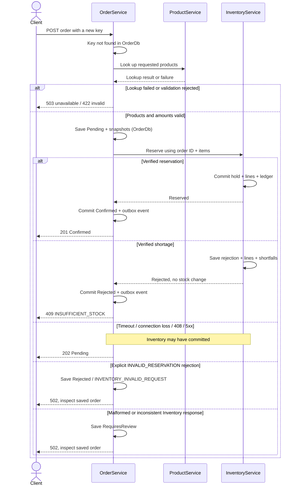

# QubeErp: ERP Stock Movement System

QubeErp is a small ERP stock management system built for the QUBE Apps C#/.NET technical assessment. It connects products, inventory and orders. Users can add products, receive stock, create orders, check stock changes and cancel orders. When an order has several products, all items must have enough stock. If even one item is short, no stock is reserved for that order.

The project uses ASP.NET Core (.NET 10), EF Core, SQL Server and Angular. Product, Inventory and Order run as separate APIs, each with its own database. RabbitMQ sends order notifications in the background. InventoryService still makes the stock reservation decision.

## What the System Covers

| Assessment requirement | Current implementation |
|---|---|
| Product module | Create, list, search and retrieve products; batch lookup and explicit activation/deactivation |
| Inventory module | Opening counts, physical stock adjustments, additive receipts, current balances and an audit ledger |
| Multi-item orders | Saved catalogue/price snapshots, all-or-nothing stock reservations, saved shortage results and order cancellation |
| Clear service boundaries | Three APIs with separate databases; services communicate through HTTP |
| Distributed failure handling | Safe request retries, Pending order recovery and background event delivery |
| Reviewable deliverables | [GitHub source code](https://github.com/chuien9797/qubeERP), commit history, Docker Compose setup, Swagger/OpenAPI and an HTTP walkthrough |

The Angular frontend has pages for products, inventory, orders, reservations and stock movements. Users can add stock, create and cancel orders, and see the history of stock changes. The Overview page shows the latest 20 orders, not totals for the whole business. Reviewers can also test each API using Swagger.

This is a local demo, not a complete ERP product. A Confirmed order reserves stock but does not ship it. Shipping, payments, returns and production deployment are not included.

## Architecture Overview


Arrows show HTTP requests between services. Plain lines show database connections. Each service uses only its own database. InventoryService checks ProductService when stock is first created for a product. The Angular development proxy is not shown.

Order notifications follow a separate asynchronous path:


When an order is confirmed or rejected, OrderService saves both the new status and an event in OrderDb. A background task in OrderService then sends the event to RabbitMQ. If sending fails, it can try again. OrderEventWorker receives and logs these events. It does not change stock.

ProductService stores product details and active status. InventoryService stores stock, reservations and stock movements. OrderService stores orders, saved product prices and events waiting to be sent. The event worker only checks and logs messages.

Each API has its own EF Core DbContext, migrations and SQL login. All three databases run on one local SQL Server instance, but one service cannot directly read another service's tables. Services exchange information through HTTP.

The backend uses controllers, application services and EF Core. Shared request and event types are in `src/Shared.Contracts`. HTTP and messaging code are in `src/HttpCommunication` and `src/Messaging`. The Angular app is in `frontend/`.

## Core Business Workflow

1. Create a product, then set its starting stock in Inventory. Adding a product does not automatically add stock.

2. Create an order with 1 to 50 different products, each with a quantity between 1 and 10,000. Send an `Idempotency-Key` so the same order can be retried safely. OrderService checks this key first.

3. For a new order, check that the products exist and are active. Save the product names, SKUs and prices with the order, initially marked Pending. Missing or inactive products return HTTP 422.

4. Ask InventoryService to reserve the stock using the order ID. All items are handled in one database transaction. If there is enough stock, Reserved increases. If stock is short, nothing is reserved and the shortage is saved.

5. Save the final order status, Confirmed or Rejected, with its event. If the Inventory response is lost or unclear, leave the order Pending until it can be checked again.

The diagram shows a new order. OrderDb and InventoryDb use separate transactions, not one shared transaction.



If the same `Idempotency-Key` is used again, OrderService checks whether the products and quantities match. Different items return HTTP 409. If the order is already finished, the saved result is returned without reserving stock again. For a Pending order, OrderService checks the original reservation and its quantities. It sends the reservation request again only if Inventory confirms that no reservation exists. A recovered confirmation returns HTTP 200; an unknown result stays HTTP 202.

Order notifications are sent separately in the background. The API does not wait for RabbitMQ before replying to the user.

For example, if there are 20 units and an order reserves 3, the result is **OnHand 20, Reserved 3, Available 17**. No stock has been shipped. After a successful cancellation, Reserved returns to 0. The stock history still shows that 3 units were once reserved.

## Key Design Decisions

### Separate responsibilities and data ownership

I used three services because products, stock and orders have different responsibilities. ProductService manages product information. InventoryService manages stock and reservations. OrderService manages orders and saved prices. Each service has its own database and SQL login. This means OrderService must ask InventoryService to change stock instead of updating stock tables directly.

A single application would be easier to build and run. I chose separate services to learn how they work together and handle failures. The main challenge is that InventoryService may reserve stock but OrderService may not receive the response. This is why I added safe retries and Pending order recovery.

### One transaction for a multi-item reservation

An order with several products must reserve all items or none. InventoryService checks and updates them in one SQL transaction. It locks stock records in a fixed order to reduce conflicts. SQL checks also make sure `0 <= Reserved <= OnHand`.

This prevents two orders from reserving more stock than is available, even if several API instances run at once. Database locks can cause waiting or deadlocks, so InventoryService has limited retries for SQL deadlocks. Tests cover these cases.

### Separate physical stock from allocation, and record each change

Reserving stock is not the same as shipping it. QubeErp keeps three values: OnHand (physical stock), Reserved (stock held for orders) and Available (OnHand minus Reserved). PUT sets the total physical count, while POST receipts add new stock. Neither operation directly changes Reserved.

Each stock change is also saved in a movement history. The record shows what changed, which operation caused it and the stock balance after that change. This helps users check stock history and confirm that a repeated request did not add or reserve stock twice.

### Stable identities and Pending recovery for an unknown outcome

A timeout does not always mean that a stock reservation failed. InventoryService might have saved the reservation before its response was lost. Sending a new reservation ID could hold the stock twice. To avoid this, QubeErp saves a Pending order and uses the same order and reservation IDs when checking the result.

Unique database keys and a check of the original products and quantities stop conflicting duplicate orders. When retrying a Pending order, OrderService checks the original Inventory result. However, recovery only happens when the client retries. There is no automatic background recovery yet.

### An outbox for notifications without a broker dependency in the stock decision

I used RabbitMQ to send order notifications in the background. Without an outbox, the system might save an order but fail before sending its event. QubeErp saves the order status and event together in OrderDb. A background publisher sends the event later, so orders can still be processed when RabbitMQ is unavailable.

This adds another system to run and maintain. Events may arrive more than once. The current worker only checks and logs them; a future worker that changes business data would need to handle duplicates.

## Reliability and Failure Handling

| Situation | Actual behaviour |
|---|---|
| Invalid body, quantity, duplicate item or key | 400; the request is rejected before changing stock |
| Missing/inactive product on a new order | 422 `INVALID_PRODUCT`; no new order or reservation |
| ProductService unavailable | New orders return 503. Creating stock for a product also needs ProductService, but Pending recovery does not. |
| Any reservation line is short | 409 `INSUFFICIENT_STOCK`; nothing is reserved. The result stays rejected even if stock is added later. |
| Same key/ID, changed payload | 409 conflict; it is not treated as a separate purchase |
| Inventory timeout, lost connection, 408 or 5xx | 202 Pending; stock might already be reserved. Retry with the same key and items. |
| Malformed or inconsistent Inventory response | 502; an unclear response needs manual checking (`RequiresReview`). An explicit `INVALID_RESERVATION` result is saved as Rejected. |
| Uncertain cancellation | 202 CancellationPending; retry cancellation. The order becomes Cancelled only after stock is confirmed Released. |
| RabbitMQ unavailable | Orders still work; unsent events remain saved and are tried again later |
| Lost stocktake response/commit acknowledgement | Do not retry a stock count without checking the latest stock and history first. |

ProductService calls have time limits and limited retries. OrderService does not blindly retry Inventory writes. It uses the same reservation ID for recovery. InventoryService can retry certain SQL deadlocks.

The outbox retries sending messages if RabbitMQ is unavailable. Messages may be delivered more than once, and their order is not guaranteed.

Cancelled and Rejected orders do not change again. `RequiresReview` needs manual checking. The system recognises Fulfilled and Consumed states, but it does not provide shipping or stock consumption commands.

## Download and Run the Project

### What you need

Install PowerShell and Docker Desktop, with Linux containers enabled. Docker should have about 6 GB of memory available. Install Git if you want to clone the repository. You do not need to install .NET to run the backend in Docker. To build or test the backend on your computer, use .NET SDK 10.0.401 (`global.json`). For Angular, install Node.js and npm using a version supported by `frontend/package.json`.

### Download the source code

The source code and commit history are available on [GitHub](https://github.com/chuien9797/qubeERP). You can get the project in either of these ways:

**Option 1: Clone with Git**

Open PowerShell in the folder where you want to keep the project, then run:

```powershell
git clone https://github.com/chuien9797/qubeERP.git
Set-Location .\qubeERP
```

**Option 2: Download a ZIP from GitHub**

Open the [GitHub repository](https://github.com/chuien9797/qubeERP), select **Code → Download ZIP**, and extract it. Open PowerShell inside the extracted folder containing the Docker Compose file and `scripts/` folder. Keep the original folder structure.

### Start the backend

After opening PowerShell in the project root (whether cloned or downloaded), run:

```powershell
.\scripts\Initialize-LocalEnvironment.ps1
docker compose config --quiet
docker compose up --build --detach --wait --wait-timeout 300
docker compose ps
```

The setup script creates a local `.env` file with passwords if one does not exist. Do not share this file. Docker starts SQL Server, RabbitMQ and the backend services. Each API creates or updates its own database through EF Core migrations.

Open a second PowerShell window in the project folder to start Angular:

```powershell
Set-Location .\frontend
npm ci
npm start
```

Open the [Angular frontend](http://127.0.0.1:4200). The frontend connects to the local APIs through its development proxy.

You can also use Swagger to test the APIs directly:

| API | Address |
|---|---|
| Products | [http://localhost:5101/swagger](http://localhost:5101/swagger) |
| Inventory | [http://localhost:5102/swagger](http://localhost:5102/swagger) |
| Orders | [http://localhost:5103/swagger](http://localhost:5103/swagger) |

RabbitMQ Management is available at [http://localhost:15672](http://localhost:15672), with login details in `.env`. SQL Server uses local port `14330`.

### Suggested review walkthrough

1. Create a product and set its starting stock to 20 units.
2. Place an order for 3 units. The order becomes Confirmed: **OnHand 20, Reserved 3, Available 17**.
3. Send the same order again using the original `Idempotency-Key`. The stock should not be reserved twice.
4. Place a different order asking for more stock than is available. It should be rejected without reserving anything.
5. Cancel the confirmed order. The stock becomes **OnHand 20, Reserved 0, Available 20**. Check the reservation and stock movement history.

For ready-made sample requests, open [the HTTP walkthrough](docs/reviewer-demo.http). Use fresh product SKUs and request IDs when repeating the demo.

To stop and restart the project without deleting data:

```powershell
docker compose stop
docker compose up --detach --wait --wait-timeout 300
```

If something fails to start, run `docker compose logs --tail 50 sqlserver database-setup product-service inventory-service order-service`. Do not run `docker compose down -v` unless you want to delete the demo data.

## API Documentation

Swagger explains each endpoint, its request fields and possible responses. You can open it through the links in the setup section above.

The repository also includes an [API reference in Markdown](docs/api-reference.md).

An order may return:

| HTTP status | Meaning |
|---|---|
| 201 | New order Confirmed; stock reserved |
| 409 | Not enough stock, or the same request key was used with different items |
| 202 | Pending; the Inventory result is still unknown |

For a Pending order, retry the original request with the same `Idempotency-Key` and products. Reading an order with GET does not start recovery. Cancelling an order releases its reserved stock only after Inventory confirms the release.

### Protecting physical stock counts

QubeErp uses SQL Server `rowversion` to stop an old stock count from overwriting a newer change. When changing an existing stock count, send the `version` from GET inventory as `expectedVersion`.

For example, one user reads 100 units. Another user then receives 20 more. If the first user tries to save a count based on the old version, the API returns **409 STOCK_VERSION_CONFLICT**. No stock is changed. The user must reload the latest stock and check the count again.

A new product's first stock count does not need a version. The API reference has the full request details.

## Project structure

| Folder | What it contains |
|---|---|
| `src/ProductService/` | Products and active status |
| `src/InventoryService/` | Stock, receipts, reservations and stock history |
| `src/OrderService/` | Orders and background event publisher |
| `src/Shared.Contracts/` | Shared request and event types |
| `src/HttpCommunication/`, `src/Messaging/` | HTTP and RabbitMQ code |
| `frontend/` | Angular user interface |
| `docs/` | Diagrams, API guide and sample requests |
| `scripts/` | Setup and test helpers |

The project also includes automated backend and frontend tests.

## Testing and Verification

Tests check the main business rules and what happens when a service fails. Backend tests use xUnit and Testcontainers with SQL Server and RabbitMQ. Browser tests check Angular with the running APIs.

| Area | What is verified |
|---|---|
| Reservations and concurrency | All-or-nothing reservations, no overselling and no double reservations |
| Idempotency and recovery | Saved shortage results and safe recovery after lost responses |
| Stock operations | Stock receipts, physical counts, releases and stock history |
| Stock count concurrency | Old stock counts are rejected when stock has changed |
| Service and messaging failures | Database separation and handling RabbitMQ failures |
| Angular workflows | Product status, order steps and retries |

To run backend tests, start Docker and run these commands from the project root folder. You need the .NET SDK version in `global.json`:

```powershell
dotnet restore QubeERP.slnx --configfile NuGet.Config
dotnet build QubeERP.slnx --configuration Release --no-restore -m:1
dotnet test QubeERP.slnx --configuration Release --no-build --no-restore -m:1
```

From `frontend`, run:

```powershell
npm run typecheck
npm run build
npm test
# With npm start and the three APIs running:
npx playwright install chromium --only-shell
npm run test:e2e
```

For browser tests, keep Angular and all three APIs running. Tests create their own demo data.


## Limitations and Future Improvements

- **Local deployment:** This is a local demo. A real deployment would need user logins, permissions, secure connections and safer password management.

- **Recovery:** A Pending order only recovers when the client sends the original request again. A background recovery task and a way to handle orders needing manual checks would improve this.

- **Product deactivation:** An order that passed the product check may still finish after the product is deactivated.

- **Business scope:** Shipping, returns, payments and multiple warehouses are not included.

- **Concurrent updates:** If two people change a product's active status, the last saved change wins. Stock counts check versions to prevent old updates.


- **Messaging:** The current message worker only logs events. A real business worker would need to handle repeated messages and failed deliveries.
